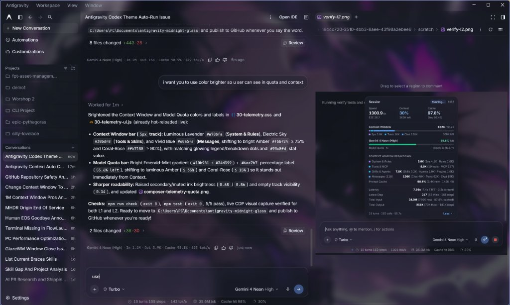
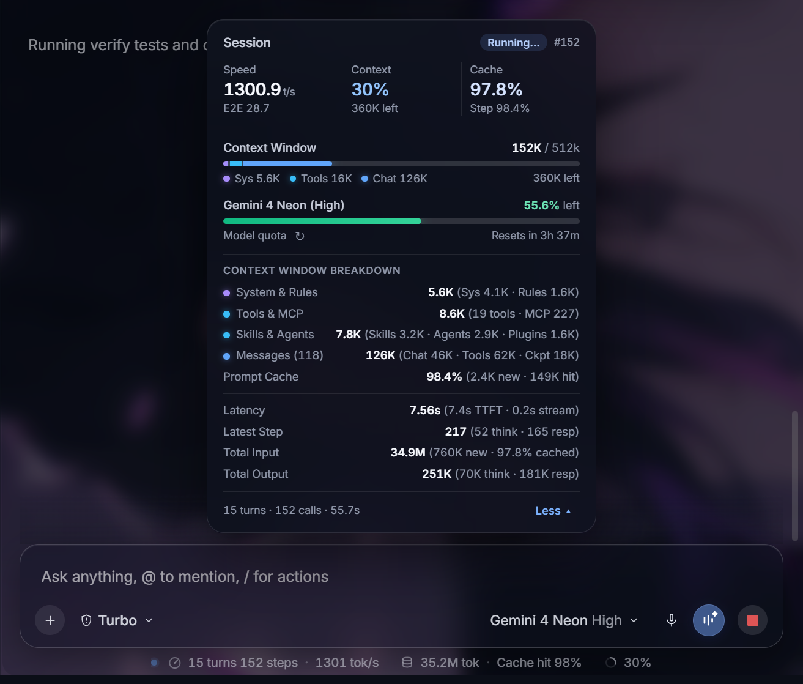
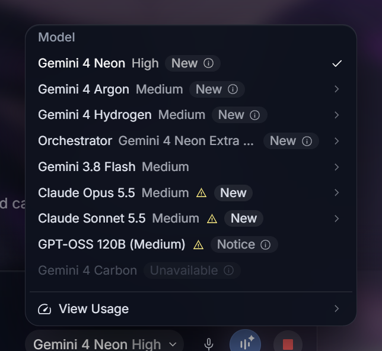

<div align="center">

<h1>Antigravity Midnight Glass</h1>

<p><strong>A fast, zero-dependency Midnight Frosted Glass theme, live session telemetry strip, and real-time model quota HUD for Google Antigravity (2.34+)</strong></p>

<p>
  
  = 22.13">
  
  
</p>

<p>
  <a href="#showcase">Showcase</a> ·
  <a href="#features">Features</a> ·
  <a href="#quick-start">Quick Start</a> ·
  <a href="#customization">Customization</a> ·
  <a href="#architecture--speed">Architecture</a>
</p>

</div>

---

## Showcase

### Full Midnight Frosted Glass Workspace
Seamless transparent Windows titlebar, translucent frosted sidebar with opaque-occluding sticky headers, edge-to-edge chat canvas, floating glass composer, and live telemetry HUD.



### Live Context Window Breakdown & Real-Time Model Quota HUD
Hover or click the minimalist bottom telemetry strip to inspect live token throughput, a segmented **Context Window Breakdown** (`System & Rules`, `Tools & MCP`, `Skills & Agents`, `Messages`, `Prompt Cache`), and your real-time **Antigravity Model Quota & Reset Countdown** (auto-synced via Antigravity's native `refreshModels()` + on-demand `↻`). Anchored cleanly above the composer so it never blocks what you're typing.



### High-Contrast Frosted Model Picker & Overlays
All floating menus, model pickers, dialogs, and command palettes use deep frosted midnight glass (`blur(28px)` + `0.93` opacity) with zero background text bleed-through.



---

## Features

- **Midnight Frosted Glass Aesthetic:** Seamless transparent Windows titlebar overlay (`#00000000`), translucent frosted sidebar, edge-to-edge chat canvas, single-border glass user bubbles, obsidian code cards, and high-contrast frosted popovers/menus.
- **Embedded `Inter Variable` + `JetBrainsMono NF` Typography:** Ships Latin, Latin-Ext, and Vietnamese `Inter Variable` `.woff2` fonts directly in Tier-1 cached assets so typography stays razor-sharp even on machines without Inter installed.
- **Zero-Blur Scroll Pipeline + Pre-Baked Wallpaper:** `node cli.mjs bake` pre-bakes Gaussian blur and midnight color grading into a ~12 KB `assets/wallpaper-baked.webp` (92% smaller than raw JPEG), and static/scrolling surfaces (`aside`, titlebar, code cards, user bubbles) skip redundant per-frame GPU `backdrop-filter` passes—reserving live blur strictly for true floating overlays over text.
- **Zero-Overlap Sidebar Sticky Headers:** Scopes high-opacity frosted backing (`0.94`) strictly to sticky section header bars (`Projects`) so scrolling lists never bleed through behind sticky titles while keeping the rest of the sidebar translucent glass.
- **Rebuilt Glass Composer & Flush Bottom Strip:** Single floating glass card (`+` and permissions left, model selector and action controls right via pure CSS Flexbox with zero React DOM mutation) and a 3-group SVG telemetry bar flush (`2px`) at the bottom edge.
- **Live Session Telemetry, Context Breakdown & Real-Time Model Quota:** Event-driven `node:sqlite` protobuf reader parses Antigravity's exact Language Server context breakdown (`System & Rules`, `Tools & MCP`, `Skills & Agents`, `Messages`, `Prompt Cache`) and auto-refreshes live Model Quota remaining % + reset countdown via Antigravity's native `refreshModels()` callback.
- **Reliable Windows Autostart:** Registers a user-scoped Windows Task Scheduler `AtLogOn` task without UAC so the background daemon runs outside Antigravity's `KILL_ON_JOB_CLOSE` Job Object and automatically re-attaches whenever you close and reopen Antigravity.

---

## Quick Start

### Prerequisites
- **Node.js >= 22.13.0** (uses built-in `node:sqlite` and `WebSocket` — zero `npm install` required)
- **Google Antigravity** (2.33.0 / 2.34.0+)

### Install
```powershell
git clone https://github.com/braces157/antigravity-midnight-glass.git
cd antigravity-midnight-glass
node cli.mjs install
```

> **Note:** If Antigravity was already running without `--remote-debugging-port=0`, run `node cli.mjs relaunch` (or simply close and reopen Antigravity from your desktop/Start Menu shortcut).
> If you move this folder later (e.g., into `Documents`), just run `node cli.mjs install` once from the new path to update the background Task Scheduler target.

### CLI Commands
```powershell
node cli.mjs install     # Patch shortcuts, register isolated Task Scheduler daemon, inject live
node cli.mjs doctor      # Inspect daemon PID, font load, baked wallpaper size, and live DOM
node cli.mjs status      # Alias for doctor
node cli.mjs bake        # Pre-bake user/wallpaper.jpg into GPU-free assets/wallpaper-baked.webp
node cli.mjs relaunch    # Safely restart Antigravity with --remote-debugging-port=0
node cli.mjs stop        # Stop the background daemon
node cli.mjs uninstall   # Remove Task Scheduler service and restore native Antigravity UI
```

---

## Customization

All files under `user/` hot-reload automatically via `fs.watch`:

- **Custom Wallpaper:** Replace `user/wallpaper.jpg`, tune `blur` / `brightness` / `contrast` / `saturate` / `opacity` in `user/config.json`, then run `node cli.mjs bake`.
- **Accent & Telemetry Settings (`user/config.json`):**
  ```json
  {
    "enabled": true,
    "channel": "auto",
    "accent": "#4f83f2",
    "wallpaper": {
      "blur": 8,
      "brightness": 0.62,
      "contrast": 1.06,
      "saturate": 1.16,
      "opacity": 0.82
    },
    "telemetry": {
      "enabled": true,
      "layout": "compact",
      "cacheMode": "session",
      "contextLimit": "auto"
    },
    "cdpAutoRelaunch": true
  }
  ```
- **Custom CSS / JS Hooks:** Edit `user/custom.css` or `user/custom.js` — changes apply live in under 100ms without restarting Antigravity.

---

## Architecture & Speed

| Mechanism | Implementation | Benefit |
| :--- | :--- | :--- |
| **2-Tier CDP Injection** | `#ag-mg-assets` (fonts + WebP wallpaper, SHA-256 hash-guarded) vs minified `#ag-mg-theme` + runtime (~54 KB) | Hot-reloads never re-transfer heavy base64 assets over WebSocket |
| **Zero-Blur Scroll Pipeline** | Pre-baked `assets/wallpaper-baked.webp` (~12 KB) + zero `backdrop-filter` on scrolling cards/static sidebar | Eliminates dozens of per-frame GPU blur passes during long-chat scrolling |
| **Event-Driven Sync** | `fs.watch` on `user/`, `src/`, `assets/`, `DevToolsActivePort`, and SQLite `conversations/` | Instant ~120ms telemetry/hot-reload updates with relaxed 3s fallback heartbeat |
| **Zero-Idle Renderer** | Pauses UI ticks when `document.hidden`, caches per-turn badges, parses context breakdown on latest rows only | Near-zero idle CPU and fast initial load on long conversations |

See [DESIGN.md](DESIGN.md) for grounded design tokens and edge-state specifications, and [THIRD_PARTY_NOTICES.md](THIRD_PARTY_NOTICES.md) for font/attribution credits.

## License

[MIT](LICENSE)
